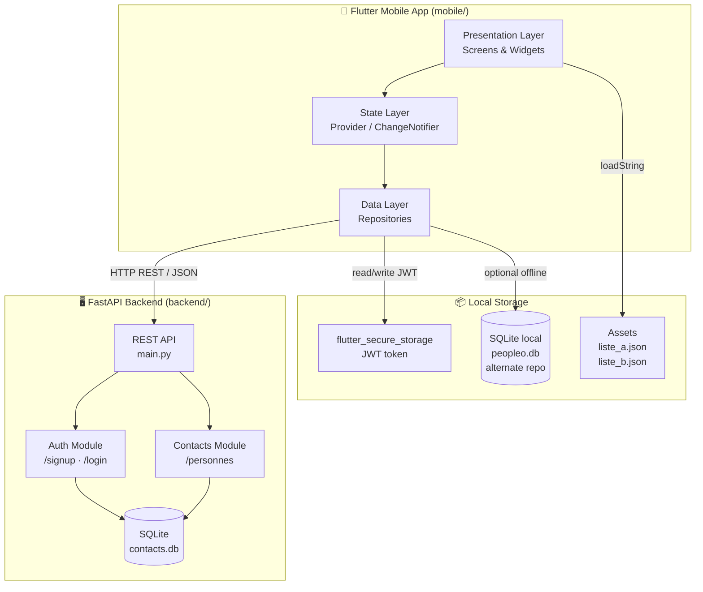
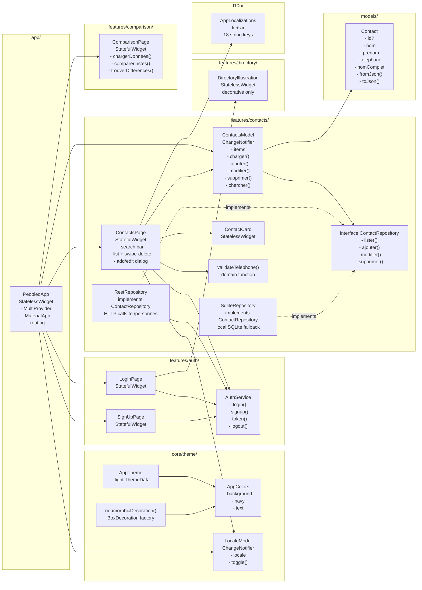
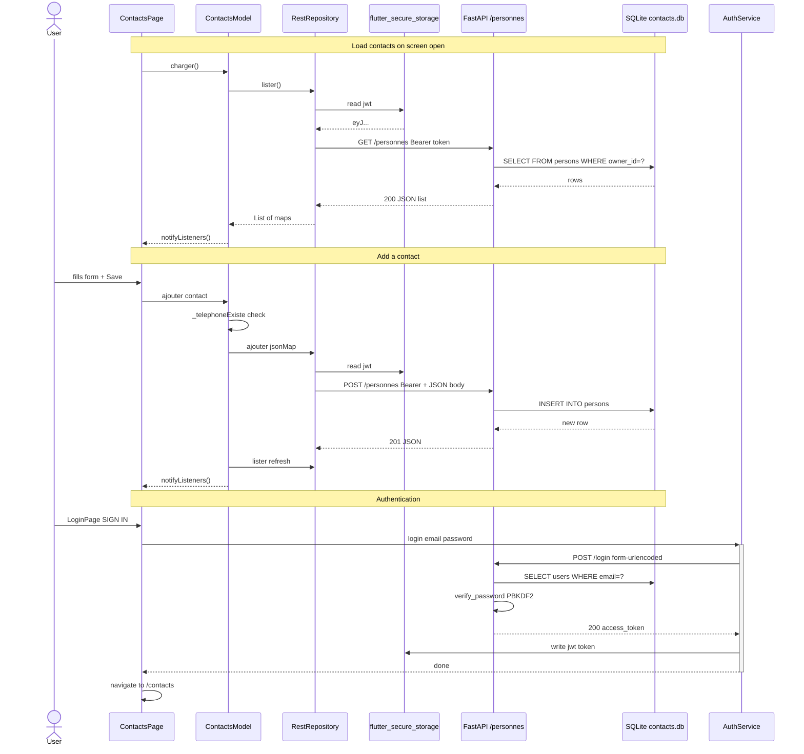
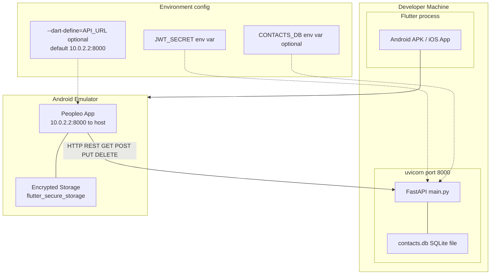
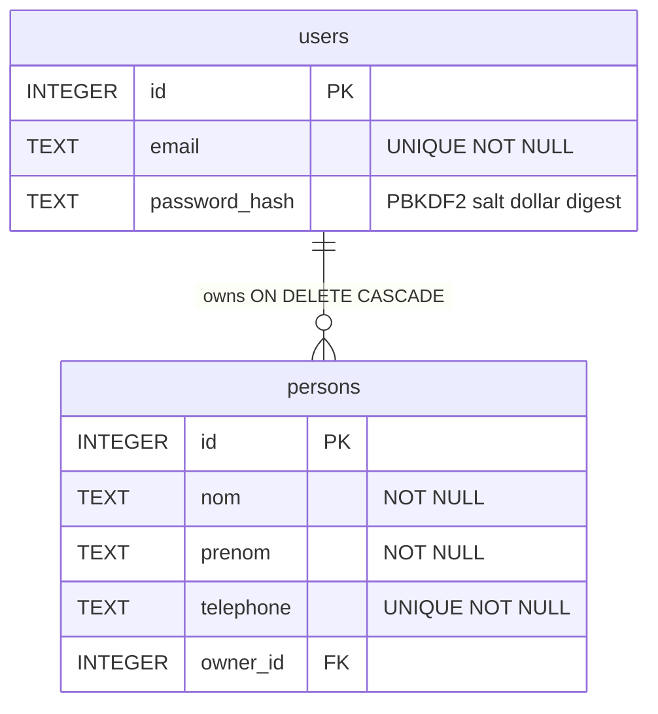

# Peopleo Contacts — Architecture Documentation

> Generated from source code analysis. All components and relationships are verified from the actual code.

---

## 1. High-Level Architecture

---

## 2. Detailed Component Diagram

---

## 3. Data Flow — CRUD and Authentication

---

## 4. Deployment Diagram

---

## 5. Database Schema

---

## Technology Stack

| Component | Technology | Version |
|---|---|---|
| Backend framework | FastAPI | >= 0.115, < 1 |
| Backend server | Uvicorn | >= 0.30, < 1 |
| Backend database | SQLite | stdlib |
| Backend auth | PBKDF2-HMAC-SHA256 + HS256 JWT | stdlib |
| Form parsing | python-multipart | >= 0.0.9 |
| Mobile framework | Flutter / Dart | SDK ^3.13.5 |
| State management | Provider | ^6.1.5 |
| HTTP client | http | ^1.6.0 |
| Secure token storage | flutter_secure_storage | ^10.0.0 |
| Local DB alternate | sqflite | ^2.4.2 |
| Localization | flutter_localizations | SDK · fr + ar |
| Backend tests | pytest + httpx | >= 8, >= 0.27 |
| Flutter tests | flutter_test | SDK |
| Linting | flutter_lints | ^6.0.0 |
